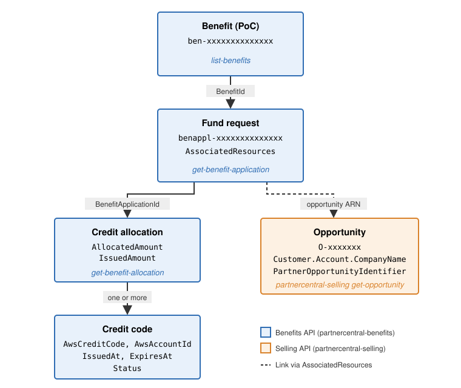

# Retrieving Proof of Concept Issued Credits in Bulk from AWS Partner Central

This guide shows how to export the **Issued credit amount** and **Issued date** for Proof of Concept (PoC) fund requests in AWS Partner Central as JSON, using the AWS CLI and `jq`. Each fund request record also includes its **Fund request ID**, **Opportunity ID**, **Company name** and **Partner opportunity identifier**.

You can run it in two modes:

- **All PoC fund requests.** This is the default. It finds every PoC fund request automatically.
- **A fixed list of fund request IDs.** For example, the 13 `benappl-…` IDs from the Funding dashboard.

---

## 1. How the data fits together

The fields you see in the console come from three API objects, linked by IDs:



The **Credit code** box is each row of the console's Credit codes table. Blue boxes come from the **Benefits API** (`partnercentral-benefits`). The orange box comes from the **Selling API** (`partnercentral-selling`). The dashed arrow is the link from a fund request to its opportunity.

| Output field | Console label | API source |
|---|---|---|
| `fundRequestId` | Fund request ID | Allocation `BenefitApplicationId` |
| `opportunityId` | Associated opportunity | Last segment of the opportunity ARN in the fund request's `AssociatedResources` |
| `companyName` | Customer company name | Opportunity `Customer.Account.CompanyName` |
| `partnerOpportunityIdentifier` | Partner opportunity identifier | Opportunity `PartnerOpportunityIdentifier` |
| `issuedAmount` | Issued credit amount (USD) | Allocation `FulfillmentDetail.CreditDetails.IssuedAmount` |
| `allocatedAmount` | Total allocated amount (USD) | Allocation `FulfillmentDetail.CreditDetails.AllocatedAmount` |
| `creditCodes[].issuedAt` | Credit codes → Issued date (UTC) | Credit code `IssuedAt` |
| `creditCodes[].expiresAt` | Credit codes → Expiration date (UTC) | Credit code `ExpiresAt` |

---

## 2. Prerequisites

- **AWS CLI v2, recent version.** The `partnercentral-benefits` commands only exist in newer releases. Check with `aws --version`, then run:
  ```bash
  aws partnercentral-benefits help
  ```
  If the command isn't recognised, upgrade the CLI.
- **`jq` 1.6 or later.**
- **Credentials for the AWS account linked to Partner Central**, for example an SSO profile:
  ```bash
  aws sso login --profile partner-central
  export AWS_PROFILE=partner-central
  ```
- **Region `us-east-1` and catalog `AWS`.** Partner Central APIs use these. Use the catalog `Sandbox` only for testing.

---

## 3. IAM permissions

The role or user running the export needs read-only access to both the Benefits and Selling APIs. Here is a minimal policy:

```json
{
  "Version": "2012-10-17",
  "Statement": [
    {
      "Sid": "PartnerCentralBenefitsRead",
      "Effect": "Allow",
      "Action": [
        "partnercentral:ListBenefits",
        "partnercentral:GetBenefit",
        "partnercentral:ListBenefitApplications",
        "partnercentral:GetBenefitApplication",
        "partnercentral:ListBenefitAllocations",
        "partnercentral:GetBenefitAllocation"
      ],
      "Resource": "*",
      "Condition": { "StringEquals": { "partnercentral:Catalog": "AWS" } }
    },
    {
      "Sid": "PartnerCentralSellingRead",
      "Effect": "Allow",
      "Action": [
        "partnercentral:GetOpportunity",
        "partnercentral:ListOpportunities"
      ],
      "Resource": "*",
      "Condition": { "StringEquals": { "partnercentral:Catalog": "AWS" } }
    }
  ]
}
```

> **Note:** check the action names in the *Service Authorization Reference* for "AWS Partner Central" before deploying this policy. If the `Catalog` condition key blocks your calls, remove the `Condition` blocks. Broad roles such as `AWSAdministratorAccess` already include these permissions.

---

## 4. Step-by-step walkthrough

Set some common variables first:

```bash
export AWS_REGION=us-east-1
CAT=AWS
```

### Step 1: Find the Proof of Concept benefit ID

```bash
aws partnercentral-benefits list-benefits --catalog $CAT --output json \
  | jq -r '.BenefitSummaries[] | "\(.Id)\t\(.Name)"'
```

Look for the benefit whose name contains *Proof of Concept* (the ID has the form `ben-xxxxxxxxxxxxxx`). Save it:

```bash
POC_BENEFIT_ID=$(aws partnercentral-benefits list-benefits --catalog $CAT --output json \
  | jq -r '[.BenefitSummaries[] | select(.Name | test("proof of concept|\\bpoc\\b"; "i")) | .Id] | join(" ")')
echo "$POC_BENEFIT_ID"
```

### Step 2: List the PoC credit allocations

**Mode A: all PoC fund requests**

```bash
# The API accepts only ONE benefit ID per call, so loop over them
for ben in $POC_BENEFIT_ID; do
  aws partnercentral-benefits list-benefit-allocations \
    --catalog $CAT --benefit-identifiers "$ben" \
    --fulfillment-types CREDITS --output json
done | jq -s '{BenefitAllocationSummaries: map(.BenefitAllocationSummaries[])}' > allocations.json
```

**Mode B: a fixed list of fund request IDs**

```bash
FUND_REQUEST_IDS="benappl-o2fo3cog17m816 benappl-m4w87rfnkdost5 benappl-ujhx8aihiyt1a6 \
benappl-itxwh2kkq12xbq benappl-b0582uqiy71lir benappl-rrccg04obb6l1k \
benappl-z4qx28vszqb713 benappl-jq4zrrhj147e14 benappl-azjt2brk1mj8r0 \
benappl-i7ic6q1p4jfuzu benappl-ym0mds5ve42bs5 benappl-hs6ppkhb09xasu \
benappl-0jxl4u07c4cb1c"

# The API accepts only ONE fund request ID per call, so loop over them
for app in $FUND_REQUEST_IDS; do
  aws partnercentral-benefits list-benefit-allocations \
    --catalog $CAT --benefit-application-identifiers "$app" \
    --fulfillment-types CREDITS --output json
done | jq -s '{BenefitAllocationSummaries: map(.BenefitAllocationSummaries[])}' > allocations.json
```

> **Important:** `--benefit-identifiers` and `--benefit-application-identifiers` each accept **only one value per call**. Passing several returns `ValidationException: Member must have length less than or equal to 1`, so always loop. The CLI handles pagination within each call automatically.
>
> Don't overwrite `allocations.json` by running both modes. Save the second result to a different file, such as `allocations_by_benefit.json`.

Check the result:

```bash
jq '.BenefitAllocationSummaries | length' allocations.json
jq '.BenefitAllocationSummaries[0]' allocations.json
```

### Step 3: Get the credit details for each allocation

```bash
for id in $(jq -r '.BenefitAllocationSummaries[].Id' allocations.json); do
  aws partnercentral-benefits get-benefit-allocation \
    --catalog $CAT --identifier "$id" --output json
done | jq -s '.' > allocation_details.json
```

**Before you go on, look at one raw record:**

```bash
jq '.[0].FulfillmentDetail' allocation_details.json
```

Note the exact name of the **credit code list** inside `CreditDetails` and of each code's **amount field**. This guide uses `Codes` and `Value`. If yours are different, change the `jq` filter in Step 6 and in the script.

### Step 4: Get the fund requests (and their opportunity)

Each fund request lists its linked resources in `AssociatedResources` as ARNs. The opportunity ARN ends in `/opportunity/O…`.

```bash
for app in $(jq -r '[.[].BenefitApplicationId] | unique | .[]' allocation_details.json); do
  aws partnercentral-benefits get-benefit-application \
    --catalog $CAT --identifier "$app" --output json
done | jq -s '.' > applications.json

# Check: fund request → opportunity ID
jq -r '.[] | "\(.Id)\t\([.AssociatedResources[]? | select(test("opportunity/")) | split("/") | last] | first)"' applications.json
```

### Step 5: Get the opportunities (company name and partner identifier)

```bash
for opp in $(jq -r '[.[].AssociatedResources[]? | select(test("opportunity/")) | split("/") | last] | unique | .[]' applications.json); do
  aws partnercentral-selling get-opportunity \
    --catalog $CAT --identifier "$opp" --output json
done | jq -s '.' > opportunities.json
```

### Step 6: Join everything into the final nested JSON

```bash
jq -n \
  --slurpfile alloc allocation_details.json \
  --slurpfile apps  applications.json \
  --slurpfile opps  opportunities.json '
  # lookup tables
  ($apps[0] | map({key: .Id, value: ([.AssociatedResources[]? | select(test("opportunity/")) | split("/") | last] | first)}) | from_entries) as $app2opp
  | ($opps[0] | map({key: .Id, value: .}) | from_entries) as $oppById
  | [ $alloc[0][]
      | . as $a
      | ($app2opp[$a.BenefitApplicationId]) as $oppId
      | ($oppById[$oppId // ""]) as $o
      | {
          fundRequestId:                $a.BenefitApplicationId,
          opportunityId:                $oppId,
          companyName:                  $o.Customer.Account.CompanyName,
          partnerOpportunityIdentifier: $o.PartnerOpportunityIdentifier,
          allocationId:                 $a.Id,
          allocationStatus:             $a.Status,
          allocatedAmount:              $a.FulfillmentDetail.CreditDetails.AllocatedAmount,
          issuedAmount:                 $a.FulfillmentDetail.CreditDetails.IssuedAmount,
          creditCodes: [ $a.FulfillmentDetail.CreditDetails.Codes[]? | {
              code:      .AwsCreditCode,
              accountId: .AwsAccountId,
              value:     .Value,
              status:    .Status,
              issuedAt:  .IssuedAt,
              expiresAt: .ExpiresAt
          } ]
        }
    ]' > poc_issued_credits.json
```

### Example output

```json
[
  {
    "fundRequestId": "benappl-m4w87rfnkdost5",
    "opportunityId": "O1234567",
    "companyName": "Example Customer Ltd",
    "partnerOpportunityIdentifier": "HYL-OPP-0042",
    "allocationId": "benalloc-xxxxxxxxxxxxxx",
    "allocationStatus": "FULFILLED",
    "allocatedAmount": { "Amount": "9438", "CurrencyCode": "USD" },
    "issuedAmount":    { "Amount": "9438", "CurrencyCode": "USD" },
    "creditCodes": [
      {
        "code": "PC3FJY4LC1924LL",
        "accountId": "652373593203",
        "value": { "Amount": "9438", "CurrencyCode": "USD" },
        "status": "FULFILLED",
        "issuedAt": "2026-07-31T00:00:00Z",
        "expiresAt": "2027-01-31T00:00:00Z"
      }
    ]
  }
]
```

*(The opportunity ID, company name, partner identifier and allocation ID above are placeholders.)*

---

## 5. End-to-end script

Save this as `export_poc_credits.sh` and run `chmod +x export_poc_credits.sh`.

```bash
#!/usr/bin/env bash
# Export Proof of Concept issued credits from AWS Partner Central as nested JSON.
#
# Usage:
#   ./export_poc_credits.sh                         # all PoC fund requests
#   ./export_poc_credits.sh benappl-aaa benappl-bbb # specific fund requests
#   ./export_poc_credits.sh -f ids.txt              # IDs from a file (one per line)
#
# Env: AWS_PROFILE (optional), AWS_REGION (default us-east-1), CATALOG (default AWS),
#      OUT (default poc_issued_credits.json)

set -euo pipefail

export AWS_REGION="${AWS_REGION:-us-east-1}"
CAT="${CATALOG:-AWS}"
OUT="${OUT:-poc_issued_credits.json}"
WORK="$(mktemp -d)"
trap 'rm -rf "$WORK"' EXIT

command -v jq  >/dev/null || { echo "jq is required"  >&2; exit 1; }
command -v aws >/dev/null || { echo "aws is required" >&2; exit 1; }

# Field names to check against a raw get-benefit-allocation response (see Step 3)
CODES_FIELD="${CODES_FIELD:-Codes}"
VALUE_FIELD="${VALUE_FIELD:-Value}"

# ---------- Parse arguments ----------
IDS=()
if [[ "${1:-}" == "-f" ]]; then
  mapfile -t IDS < <(grep -Eo 'benappl-[0-9a-z]{14}' "$2")
elif [[ $# -gt 0 ]]; then
  IDS=("$@")
fi

# ---------- Step 1-2: allocations ----------
if [[ ${#IDS[@]} -eq 0 ]]; then
  echo "Mode: all PoC fund requests" >&2
  POC_IDS=$(aws partnercentral-benefits list-benefits --catalog "$CAT" --output json \
    | jq -r '[.BenefitSummaries[] | select(.Name | test("proof of concept|\\bpoc\\b"; "i")) | .Id] | join(" ")')
  [[ -z "$POC_IDS" ]] && { echo "No PoC benefit found" >&2; exit 1; }
  echo "PoC benefit ID(s): $POC_IDS" >&2
  # The API accepts only one benefit ID per call
  for ben in $POC_IDS; do
    aws partnercentral-benefits list-benefit-allocations --catalog "$CAT" \
      --benefit-identifiers "$ben" --fulfillment-types CREDITS --output json
  done | jq -s '{BenefitAllocationSummaries: (map(.BenefitAllocationSummaries[]))}' > "$WORK/allocations.json"
else
  echo "Mode: ${#IDS[@]} specified fund request(s)" >&2
  # The API accepts only one fund request ID per call
  for app in "${IDS[@]}"; do
    aws partnercentral-benefits list-benefit-allocations --catalog "$CAT" \
      --benefit-application-identifiers "$app" --fulfillment-types CREDITS --output json
  done | jq -s '{BenefitAllocationSummaries: (map(.BenefitAllocationSummaries[]))}' > "$WORK/allocations.json"
fi

N=$(jq '.BenefitAllocationSummaries | length' "$WORK/allocations.json")
echo "Allocations found: $N" >&2
[[ "$N" -eq 0 ]] && { echo "[]" > "$OUT"; echo "Nothing to export." >&2; exit 0; }

# ---------- Step 3: allocation details ----------
for id in $(jq -r '.BenefitAllocationSummaries[].Id' "$WORK/allocations.json"); do
  aws partnercentral-benefits get-benefit-allocation --catalog "$CAT" --identifier "$id" --output json
done | jq -s '.' > "$WORK/alloc.json"

# ---------- Step 4: fund requests ----------
for app in $(jq -r '[.[].BenefitApplicationId // empty] | unique | .[]' "$WORK/alloc.json"); do
  aws partnercentral-benefits get-benefit-application --catalog "$CAT" --identifier "$app" --output json
done | jq -s '.' > "$WORK/apps.json"

# ---------- Step 5: opportunities ----------
OPP_IDS=$(jq -r '[.[].AssociatedResources[]? | select(test("opportunity/")) | split("/") | last] | unique | .[]' "$WORK/apps.json")
if [[ -n "$OPP_IDS" ]]; then
  for opp in $OPP_IDS; do
    aws partnercentral-selling get-opportunity --catalog "$CAT" --identifier "$opp" --output json \
      || echo "{\"Id\":\"$opp\",\"_error\":\"get-opportunity failed\"}"
  done | jq -s '.' > "$WORK/opps.json"
else
  echo "[]" > "$WORK/opps.json"
fi

# ---------- Step 6: join ----------
jq -n --arg cf "$CODES_FIELD" --arg vf "$VALUE_FIELD" \
  --slurpfile alloc "$WORK/alloc.json" \
  --slurpfile apps  "$WORK/apps.json" \
  --slurpfile opps  "$WORK/opps.json" '
  ($apps[0] | map({key: .Id, value: ([.AssociatedResources[]? | select(test("opportunity/")) | split("/") | last] | first)}) | from_entries) as $app2opp
  | ($opps[0] | map({key: .Id, value: .}) | from_entries) as $oppById
  | [ $alloc[0][]
      | . as $a
      | ($a.FulfillmentDetail.CreditDetails // {}) as $c
      | ($app2opp[$a.BenefitApplicationId]) as $oppId
      | ($oppById[$oppId // ""]) as $o
      | {
          fundRequestId:                $a.BenefitApplicationId,
          opportunityId:                $oppId,
          companyName:                  $o.Customer.Account.CompanyName,
          partnerOpportunityIdentifier: $o.PartnerOpportunityIdentifier,
          allocationId:                 $a.Id,
          allocationStatus:             $a.Status,
          allocatedAmount:              $c.AllocatedAmount,
          issuedAmount:                 $c.IssuedAmount,
          creditCodes: [ ($c[$cf] // [])[] | {
              code:      .AwsCreditCode,
              accountId: .AwsAccountId,
              value:     .[$vf],
              status:    .Status,
              issuedAt:  .IssuedAt,
              expiresAt: .ExpiresAt
          } ]
        }
    ] | sort_by(.fundRequestId)' > "$OUT"

echo "Wrote $(jq length "$OUT") record(s) to $OUT" >&2
```

**Examples:**

```bash
# All PoC fund requests
AWS_PROFILE=partner-central ./export_poc_credits.sh

# The 13 fund requests from the dashboard, saved in ids.txt
./export_poc_credits.sh -f ids.txt

# If the raw response uses different field names
CODES_FIELD=CreditCodes VALUE_FIELD=Amount ./export_poc_credits.sh
```

---

## 6. Field-name verification checklist

Some field names come straight from the API reference. Others are assumptions. Check the unconfirmed ones once against a raw response.

| Field | Status |
|---|---|
| `CreditDetails.AllocatedAmount`, `CreditDetails.IssuedAmount` | Documented |
| Credit code `AwsCreditCode`, `AwsAccountId`, `Status`, `IssuedAt`, `ExpiresAt` | Documented |
| Fund request `AssociatedResources` (array of ARNs) | Documented |
| Name of the credit code list inside `CreditDetails` (`Codes`) | **Check.** Set `CODES_FIELD` |
| Credit code amount field (`Value`) | **Check.** Set `VALUE_FIELD` |
| `FulfillmentDetail.CreditDetails` path on the allocation | **Check** with `jq '.[0].FulfillmentDetail'` |
| Opportunity `Customer.Account.CompanyName`, `PartnerOpportunityIdentifier` | Partner Central Selling API |
| `--benefit-identifiers`, `--benefit-application-identifiers` CLI flags | Confirmed working. **One value per call** |

---

## 7. Troubleshooting

| Symptom | Likely cause | Fix |
|---|---|---|
| `Invalid choice: 'partnercentral-benefits'` | The AWS CLI is too old | Upgrade AWS CLI v2 |
| `AccessDeniedException` | Missing IAM permission, or wrong account/profile | Use the account linked to Partner Central; add the policy in §3 |
| `ValidationException` on `--catalog` | Wrong catalog or region | Use `--catalog AWS` and `us-east-1` |
| `ValidationException … length less than or equal to 1` | More than one ID was passed in a single call | Loop over the IDs one at a time (see Step 2); the script already does this |
| `Unknown options: --benefit-application-identifiers` | The flag name is different in your CLI version | Check `… list-benefit-allocations help`; the script's one-ID-at-a-time loop also works |
| `creditCodes` is always `[]` | The credit code list has a different name | Look at `jq '.[0].FulfillmentDetail.CreditDetails \| keys'` and set `CODES_FIELD` |
| `value` is `null` | The code amount field has a different name | Set `VALUE_FIELD` (e.g. `Amount`) |
| `opportunityId` is `null` | The fund request has no linked opportunity, or the ARN pattern is different | Check `jq '.[].AssociatedResources' applications.json` |
| `companyName` is `null` | `get-opportunity` failed (the record has `_error`), or the opportunity belongs to another catalog | Run `get-opportunity` by hand for that ID; check Selling API permissions |
| No PoC benefit found | The benefit name doesn't match the regex | List all names (Step 1) and set the benefit ID yourself |
| `ThrottlingException` | Too many calls in a row | Add `sleep 0.2` inside the loops, or set `AWS_MAX_ATTEMPTS=10` and `AWS_RETRY_MODE=adaptive` |
| Fewer allocations than fund requests | The fund request has no credits issued yet, or was paid in cash | Remove `--fulfillment-types CREDITS` to include `CASH`, and read `CashDetails` |

---

## 8. References

- [Working with Benefit Allocations (Developer Guide)](https://docs.aws.amazon.com/partner-central/latest/developer-guide/working-with-benefit-allocations.html)
- [ListBenefitAllocations (API Reference)](https://docs.aws.amazon.com/partner-central/latest/APIReference/API_benefits_ListBenefitAllocations.html)
- [GetBenefitApplication (API Reference)](https://docs.aws.amazon.com/partner-central/latest/APIReference/API_benefits_GetBenefitApplication.html)
- [CreditDetails](https://docs.aws.amazon.com/partner-central/latest/APIReference/API_benefits_CreditDetails.html) · [CreditCode](https://docs.aws.amazon.com/partner-central/latest/APIReference/API_benefits_CreditCode.html)
- [Using the Partner Central Benefits API](https://docs.aws.amazon.com/partner-central/latest/developer-guide/using-the-benefits-api.html)
